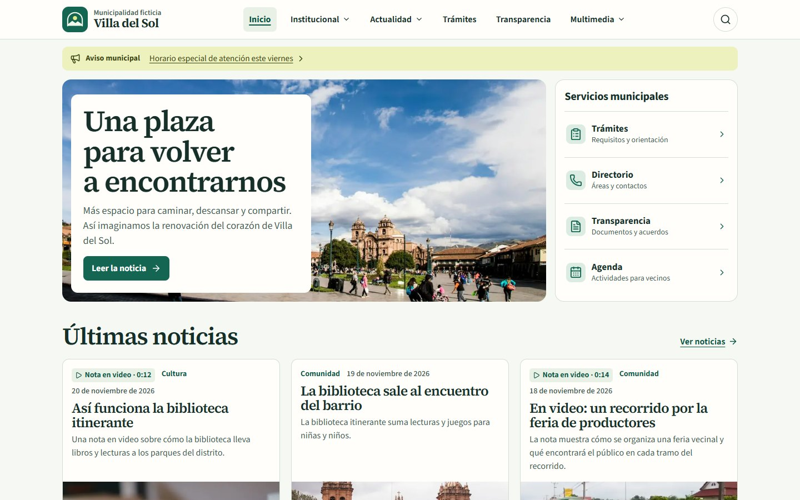
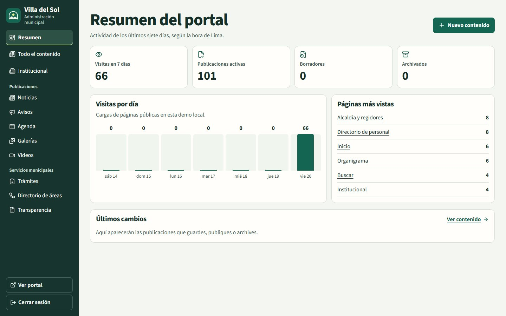

# Web Municipal

**Portal municipal genérico con CMS.** Villa del Sol es el municipio ficticio que da nombre a la demo. El proyecto muestra cómo un vecino puede encontrar información y cómo un equipo municipal puede mantenerla actualizada desde un panel.



## Portal público

- **Actualidad y multimedia** con noticias escritas, notas en video, avisos, agenda y galerías.
- **Trámites y transparencia** con fichas de requisitos, filtros por categoría y año, y documentos PDF descargables.
- **Institucional** con autoridades, organigrama navegable, directorios de áreas y personal, e imagen institucional.
- **Buscador** con sugerencias, resultados ordenados por relevancia y filtros por sección.

## Panel de administración

El CMS gestiona publicaciones, borradores, archivos adjuntos y registros institucionales. Las altas, ediciones y bajas se reflejan en el portal local. El tablero registra cargas de páginas públicas y las agrupa por día y ruta.



## Ejecutar en local

Requisito: **Node.js 24**.

```bash
npm ci
npm run setup:admin
npm run dev
```

| Vista | Dirección |
| --- | --- |
| Portal público | [localhost:3000](http://localhost:3000) |
| Panel de administración | [localhost:3000/admin](http://localhost:3000/admin) |

Al ejecutar `npm run setup:admin` en un clon nuevo, puedes entrar al panel con estas credenciales de demostración:

| Campo | Valor |
| --- | --- |
| Correo | `admin@villadelsol.example` |
| Contraseña | `VillaDelSol-Demo!` |

El comando genera una clave de sesión única por instalación y guarda el acceso en `.demo/admin-credentials.txt`. Si ya configuraste el proyecto, conserva tus credenciales actuales. SQLite se inicializa con los datos de demostración en la primera ejecución.

La configuración local, la clave de sesión, las métricas y los archivos cargados por el CMS se guardan fuera de Git. Las fotos, videos y PDF de muestra que sí se incluyen en el código permiten recorrer el portal desde un clon nuevo.

## Estructura

| Ruta | Responsabilidad |
| --- | --- |
| `app/` | Rutas públicas, panel, acciones de servidor y endpoints |
| `components/` | Navegación, tarjetas, galería y componentes del CMS |
| `lib/` | Datos iniciales, persistencia, publicación, métricas y presentación |
| `public/` | Fotos, videos, subtítulos y PDF de la demostración |
| `scripts/` | Configuración del acceso local y generación de los PDF |

Stack: **Next.js 16 con App Router**, **React**, **TypeScript**, **Auth.js**, **SQLite de Node.js**, **Motion**, **Radix UI** y **Lucide**. La interfaz está en español.

## Compilación y despliegue

```bash
npm run build
npm start
```

El modo de producción, incluido Vercel, sirve el portal público con los datos de muestra del repositorio. El CMS, las métricas y las cargas de archivos están habilitados en desarrollo local. Un CMS desplegado requeriría almacenamiento persistente y una configuración de acceso para ese entorno.

## Material de referencia

Las noticias, los nombres y los documentos municipales son ficticios. Las fotografías y los clips ilustran la demo.

- **Fotografías:** [Plaza de Armas](https://unsplash.com/photos/TuaegWPTqyU), [encuentro junto a la fuente](https://unsplash.com/photos/kBRjkENt2GE), [catedral y plaza](https://unsplash.com/photos/cLxtFRLRoNk) y [paisaje](https://images.unsplash.com/photo-1470071459604-3b5ec3a7fe05). [Licencia de Unsplash](https://unsplash.com/license).
- **Clips de referencia:** [biblioteca, cottonbro studio](https://www.pexels.com/video/choosing-a-book-from-the-bookshelves-6334041/), [mercado, Suraphat Nuea-on](https://www.pexels.com/video/street-vendors-selling-vegetables-in-the-street-4102789/) y [jardinería, Tima Miroshnichenko](https://www.pexels.com/video/a-person-gardening-6508939/). [Licencia de Pexels](https://www.pexels.com/license/).
